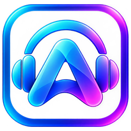
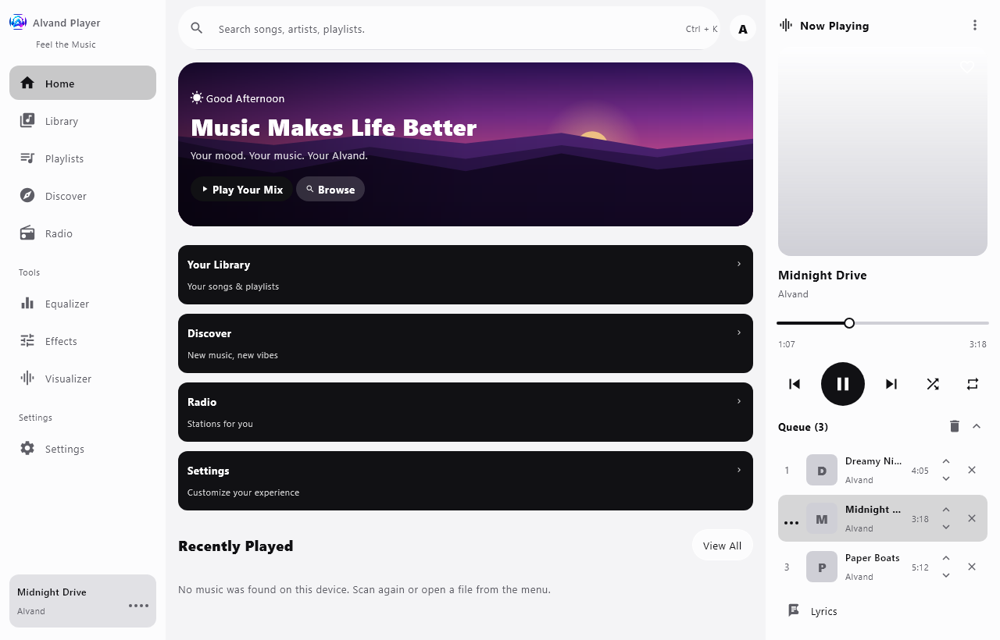
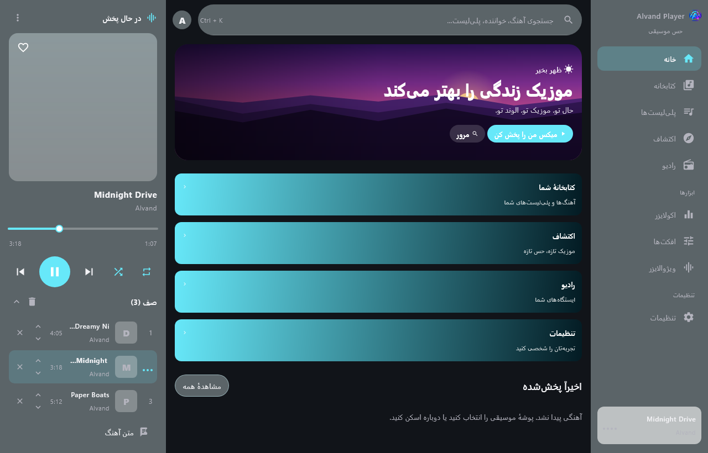
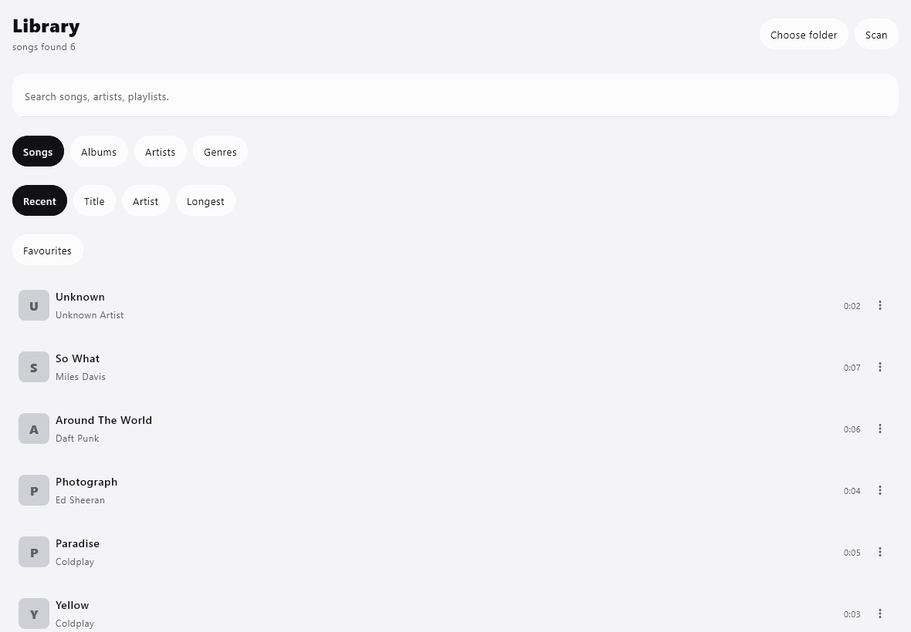
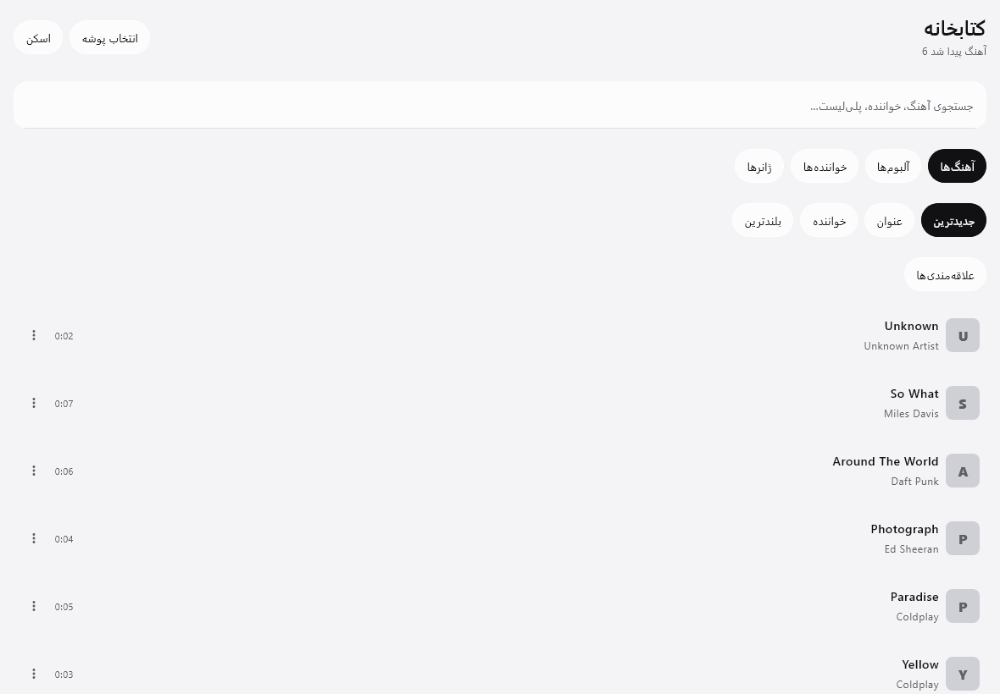

<div align="center">



# 🎵 Alvand Player — Windows

**A beautiful, privacy-first music player for Windows — no cloud, no tracking, no compromises.**

[پورت ویندوزِ **الوند پلیر** — موزیک‌پلیر اندرویدی شما، حالا روی دسکتاپ](#-فارسی)

**Kotlin · Compose Multiplatform · Pure-Java Audio · Zero Telemetry**

[](https://github.com/Alvandcode/AlvandPlayer-Windows/actions/workflows/build.yml)
[](#-english)
[](LICENSE)
[](https://kotlinlang.org)
[](https://www.jetbrains.com/lp/compose-mpp/)
[](#-build--test--ساخت-و-تست)
[](#-download--دانلود)

</div>

---

<div align="center">

**⭐ If Alvand Player finds a place on your desktop, a star is the best "thank you" — it helps others discover it.**

**⭐ اگر الوند پلیر جای خودش را روی دسکتاپ شما پیدا کرد، ستاره‌دادن صادقانه‌ترین «متشکرم» است — به دیگران هم کمک می‌کند آن را پیدا کنند.**

</div>

---

## 🇬🇧 English

### Why another music player?

Because you deserve a player that **stays on your machine**. Alvand Player is a faithful Windows port of the beloved Android *Alvand Player*: the same design language, the same DSP chain, the same careful engineering — rebuilt natively with Kotlin and Compose Multiplatform. No accounts. No telemetry. No crash uploads. Your music never leaves your PC.

### ✨ Highlights

| | |
|---|---|
| 🎧 **Real playback engine** | Custom pure-Java decoders for **WAV, MP3, FLAC, Ogg Vorbis, M4A/AAC** — no native ffmpeg, no subprocesses, no license headaches. Gapless playback, queue persistence, auto-skip of corrupt files (max 3 in a row), A–B loop. |
| 🎚️ **Full DSP** | 5-band equalizer (11 presets, identical to Android's system presets), bass boost, treble, noise reduction, room reverb, gain + limiter — all live, all persisted between runs. |
| 🖼️ **Glass design** | Light/dark themes × 4 accent themes (Minimal, Royal, Sunset, Ocean), 1:1 ported from Android's `GlassDesign.kt` — glass cards, edge shine, top glow, stage glow. |
| 📚 **Smart library** | Folder picking, drag-and-drop, auto-scan of all drives, tag reading, operator search (`artist:` / `album:` / `title:`), album/artist/genre grouping, favorites, most-played & recently-played. |
| ⌨️ **Desktop-native** | Global media keys (headset & keyboard), single-instance, tray-resident, keyboard shortcuts with an in-app cheatsheet, output device selection, floating mini-player, sleep timer. |
| 🎤 **Synced lyrics** | LRCLIB integration — opt-in only, with offline caching. |
| 🏷️ **Tag editor** | Edit title/artist/album/genre directly from the song's properties (MP3/FLAC/Ogg/M4A). |
| 🔒 **Privacy** | Zero telemetry, zero analytics, zero crash uploads. The only optional network request is lyrics search, **off by default**. |
| 📦 **Real installer** | Signed-less but complete MSI installer with Start-menu shortcut and file associations. |

### 📥 Download

Grab the latest MSI from the [**Releases**](../../releases) page, double-click, done. Or run from source:

### 📸 Screenshots

| Light (EN) | Dark · Ocean (FA) |
|---|---|
|  |  |
| **Library — Songs (EN)** | **Library — Songs (FA, RTL)** |
|  |  |

```powershell
.\gradlew.bat :desktopApp:run      # requires only JDK 17
```

### 🛠️ Build & Test

```powershell
.\gradlew.bat jvmTest              # 340+ headless tests
.\gradlew.bat :desktopApp:createDistributable
```

See [BUILD.md](BUILD.md) for details.

### 🗺️ Roadmap

WMA / Opus / ALAC decoding, SMTC (Windows volume flyout) integration, Authenticode signing. Full port-status tracking in [PORT-DIFFERENCES.md](docs/PORT-DIFFERENCES.md).

---

<div dir="rtl">

## 🇮🇷 فارسی

### چرا یک پلیر دیگر؟

چون لایق پلیری هستید که **روی خودِ سیستم شما بماند**. الوند پلیر، پورت وفادارِ ویندوزیِ *الوند پلیر اندروید* است: همان زبان طراحی، همان زنجیرهٔ DSP، همان مهندسیِ دقیق — با کاتلین و Compose Multiplatform از نو ساخته شده. نه حساب کاربری، نه تله‌متری، نه آپلود کرش. موسیقی شما هرگز از کامپیوترتان خارج نمی‌شود.

### ✨ ویژگی‌ها

| | |
|---|---|
| 🎧 **موتور پخش واقعی** | رمزگشای خالص جاوا برای **WAV، MP3، FLAC، Ogg Vorbis، M4A/AAC** — بدون ffmpeg بومی، بدون زیرپروسه، بدون دردسر لایسنس. پخش بدون شکاف، صف ماندگار، رد خودکار فایل خراب، حلقهٔ A–B. |
| 🎚️ **DSP کامل** | اکولایزر ۵ باندی (۱۱ پریست، دقیقاً پریست‌های سیستمی اندروید)، تقویت باس، بلندی، کاهش نویز، اکوی اتاق، بهره + محدودکننده — همگی زنده و ماندگار بین اجراها. |
| 🖼️ **طراحی شیشه‌ای** | تم روشن/تیره × ۴ تم رنگی (مینیمال، سلطنتی، غروب، اقیانوس)، پورت ۱:۱ از `GlassDesign.kt` اندروید — کارت‌های شیشه‌ای، برق لبه، هالهٔ بالا، هالهٔ استیج. |
| 📚 **کتابخانهٔ هوشمند** | انتخاب پوشه، کشیدن و رها کردن، اسکن خودکار همهٔ درایوها، خواندن تگ، جستجوی عملگری (`artist:` / `album:` / `title:`)، گروپ‌بندی آلبوم/خواننده/ژانر، علاقه‌مندی‌ها، پرتکرارترین‌ها و اخیراً پخش‌شده‌ها. |
| ⌨️ **بومیِ دسکتاپ** | کلیدهای مدیای سراسری (هدست و کیبورد)، تک‌نمونه‌سازی، اقامت در سینی، میانبرهای کیبورد با راهنمای درون‌برنامه‌ای، انتخاب دستگاه خروجی، مینی‌پلیر شناور، تایمر خواب. |
| 🎤 **متن آهنگ سنک‌شده** | یکپارچگی با LRCLIB — فقط با رضایت شما، با کش آفلاین. |
| 🏷️ **ویرایشگر تگ** | ویرایش عنوان/خواننده/آلبوم/ژانر از شناسنامهٔ آهنگ (MP3/FLAC/Ogg/M4A). |
| 🔒 **حریم خصوصی** | صفر تله‌متری، صفر آنالیتیک، صفر آپلود کرش. تنها درخواست شبکهٔ اختیاری، جستجوی متن آهنگ است که **پیش‌فرضش خاموش** است. |
| 📦 **نصب‌کنندهٔ واقعی** | نصب‌کنندهٔ MSI کامل با میانبر منوی استارت و انجکت فایل‌ها. |

### 📥 دانلود

آخرین MSI را از صفحهٔ [**Releases**](../../releases) بگیرید، دابل‌کلیک کنید، تمام. یا از سورس اجرا کنید:

## 📸 اسکرین‌شات‌ها

<div dir="ltr" align="center">

| روشن (EN) | تیره · اقیانوس (FA) |
|---|---|
|  |  |
| **کتابخانه (EN)** | **کتابخانه (FA، راست‌به‌چپ)** |
|  |  |

</div>

```powershell
.\gradlew.bat :desktopApp:run      # فقط JDK 17 لازم است
```

### 🛠️ ساخت و تست

```powershell
.\gradlew.bat jvmTest              # بیش از ۳۴۰ تست بدون نمایشگر
.\gradlew.bat :desktopApp:createDistributable
```

جزئیات بیشتر در [BUILD.md](BUILD.md).

### 🗺️ نقشهٔ راه

رمزگشایی WMA / Opus / ALAC، یکپارچگی با SMTC (فول‌اوت ولوم ویندوز)، امضای Authenticode. وضعیت کامل پورت در [PORT-DIFFERENCES.md](docs/PORT-DIFFERENCES.md).

---

### 🤝 حمایت از پروژه

اگر الوند پلیر به کارتان آمده، چند راه ساده برای حمایت هستید:

- ⭐ **به ریپو ستاره بدهید** — ساده‌ترین و مؤثرترین حمایت؛ پروژه را به دیده‌شدن کمک می‌کند
- 🐛 **باگ یا پیشنهاد بدهید** — هر Issue ارزشمند است و معمولاً سریع بررسی می‌شود
- 🔀 **Pull Request بفرستید** — به‌خصوص برای موارد نقشهٔ راه (WMA، Opus، SMTC)
- 📣 **به دوستان موزیک‌دوستتان معرفی کنید**

### 📢 کانال تلگرام

اخبار انتشار، اسکرین‌شات‌های نسخه‌های جدید، و نکات استفاده را در کانال تلگرام دنبال کنید:

<div dir="ltr">

**[https://t.me/a_c_official](https://t.me/a_c_official)**

</div>

</div>

---

## 📄 License / مجوز

MIT — free to use, modify, and distribute. / آزاد برای استفاده، تغییر و انتشار.

<div align="center">

**⭐ Star this repo if it deserves it — it genuinely helps.**
**⭐ اگر لایق است، ستاره بدهید — واقعاً کمک می‌کند.**

</div>
